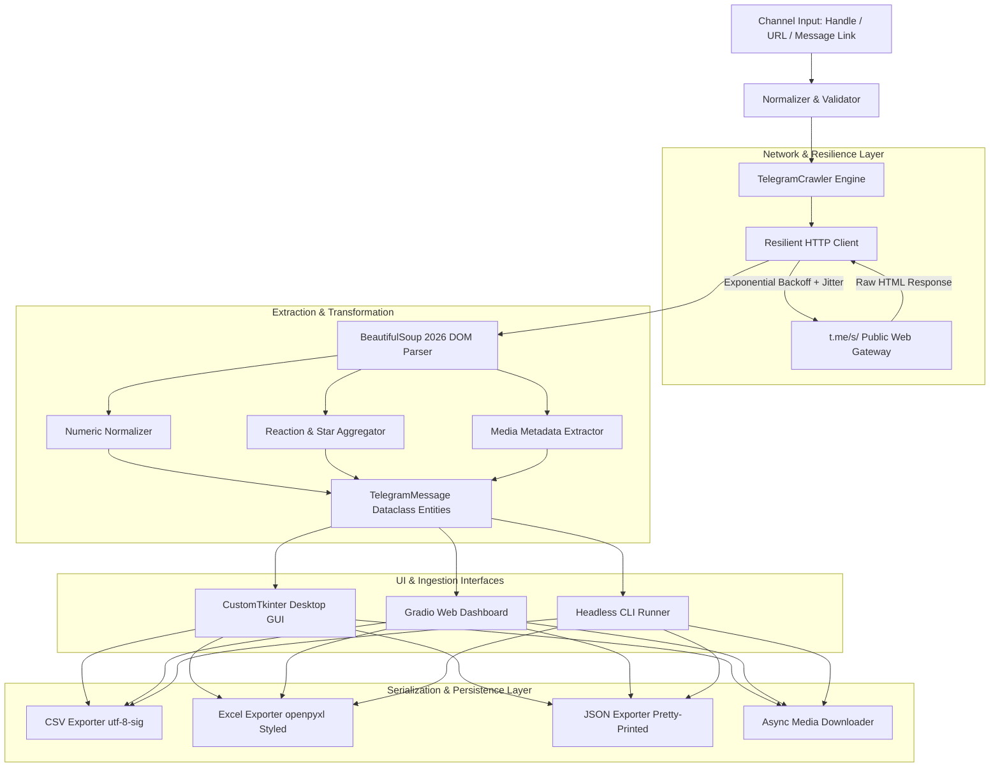

<div align="center">


# Telegram Channel Scraper

**Enterprise-grade, zero-authentication data extraction framework for public Telegram channels.**

[](https://www.python.org/downloads/)
[](https://opensource.org/licenses/MIT)
[](https://github.com/TomSchimansky/CustomTkinter)
[](https://t.me)
[](dist/TelegramScraper.exe)

</div>

---

## 1. Executive Summary

**Telegram Channel Scraper** is an enterprise-grade, zero-authentication intelligence and extraction framework engineered for public Telegram channels. Designed for Open-Source Intelligence (OSINT) practitioners, academic researchers, compliance monitors, and data engineers, it enables full-fidelity message extraction without requiring Telegram API keys (`api_id`, `api_hash`), phone number registrations, bot credentials, or session authentications.

By operating directly over Telegram's distributed web preview infrastructure (`https://t.me/s/{channel}`), the framework bypasses user-account rate quotas, avoids telephone number exposure, and eliminates the risk of account bans or credential leakage.

### Key Capabilities at a Glance

- **Authentication-Free Operation**: Zero credential requirements; queries public gateways directly.
- **2026 Telegram Schema Compatibility**: Native parsing of standard emojis, custom reaction counts, and paid **Telegram Stars (⭐)**.
- **High-Fidelity Numeric Normalization**: Converts localized view metrics (e.g., `5.84M` → `5,840,000`, `14.2K` → `14,200`) into normalized 64-bit integers.
- **Stateful Reverse-Chronological Crawling**: Follows Telegram's reverse cursor pagination (`?before={id}`) with built-in deduplication and loop detection.
- **Tri-Modal Interface**: Modern hardware-accelerated **Desktop GUI** (`CustomTkinter`), **Browser Web App** (`Gradio`), and **Terminal CLI** (`Rich`).
- **Production Data Pipelines**: One-click output serialization to Microsoft Excel (`.xlsx` with custom typographic styling), UTF-8 BOM CSV (`utf-8-sig` for international character and emoji fidelity), and schema-validated JSON.
- **Standalone Windows Distribution**: Pre-compiled single-file executable (`TelegramScraper.exe`) requiring zero dependencies or Python installations on host machines.

---

## 2. System Architecture

The following diagram illustrates the unidirectional data pipeline from public ingress to output serialization:



---

## 3. Data Schema Specification

Every extracted record is normalized into a strongly typed `TelegramMessage` model containing the following schema attributes:

| Field Name | Type | Description | Example |
| :--- | :--- | :--- | :--- |
| `id` | `int` | Unique channel-scoped message identifier | `1042` |
| `channel` | `str` | Normalized Telegram channel username | `"durov"` |
| `datetime_iso` | `str` | ISO 8601 UTC timestamp of message publication | `"2026-10-24T18:32:00+00:00"` |
| `views` | `int` | Normalized view count parsed to integer | `5840000` |
| `views_raw` | `str` | Humanized views label as rendered by Telegram | `"5.84M"` |
| `reactions` | `dict[str, int]`| Mapping of reaction emojis to engagement counts | `{"👍": 14200, "🔥": 8900}` |
| `stars` | `int` | Total count of paid Telegram Stars (⭐) awarded | `1250` |
| `text_plain` | `str` | Sanitized plain text with whitespace normalization | `"Major update announced..."` |
| `text_html` | `str` | Raw HTML preserving formatting, bold, italics, links | `"<div class='tgme_widget...'>"` |
| `is_forwarded` | `bool` | Flag denoting whether post is a forwarded message | `false` |
| `forward_from` | `str` | Original source channel or author handle (if forwarded) | `null` |
| `reply_to_id` | `int` | ID of referenced parent message (if in thread/reply) | `1039` |
| `media` | `list[MediaItem]`| Array of embedded photo, video, document, or audio URIs | `[{"media_type": "photo", ...}]` |
| `url` | `str` | Canonical direct permalink to post | `"https://t.me/durov/1042"` |

---

## 4. Installation & Getting Started

### Method A: Standalone Windows Binary (Recommended for End Users)

The project includes a pre-compiled, self-contained Windows executable requiring zero configuration:

1. Download or locate [`dist/TelegramScraper.exe`](dist/TelegramScraper.exe).
2. Double-click the file to launch the **Desktop GUI**.
3. *Note*: No Python runtime, external DLLs, or administrative privileges are required.

To compile the binary from source:
```powershell
python build_exe.py
```

---

### Method B: Python Source Installation

#### Prerequisites
- **Python**: Version `3.10` or higher (`3.11+` recommended).
- **Package Manager**: `pip` (or `uv` / `poetry`).

#### Step-by-Step Setup
```powershell
# 1. Clone repository
git clone https://github.com/placeholder/telegram-channel-scraper.git
cd telegram-channel-scraper

# 2. Initialize virtual environment
python -m venv .venv

# 3. Activate virtual environment
# Windows (PowerShell):
.venv\Scripts\Activate.ps1
# Windows (CMD):
.venv\Scripts\activate.bat
# Linux / macOS:
source .venv/bin/activate

# 4. Install production dependencies
pip install -r requirements.txt
```

---

## 5. Execution Modes & Interface Guide

### Mode 1: Modern Desktop GUI (Default)

The Desktop interface is built with CustomTkinter, designed for high contrast and sustained analytical workflows.

```powershell
python main.py
```

#### GUI Highlights:
- **Thread-Isolated Asynchronous Engine**: The GUI runs on a dedicated thread with an asyncio loop, guaranteeing zero window freezing or dropped frames during heavy network transfers.
- **Live Analytical Telemetry**: Real-time meters for collection velocity (`msgs/sec`), total accumulated views, total reactions, and cumulative Telegram Stars.
- **Zebra-Striped Data Grid**: Native ttk-backed tree view with dynamic alternating colors (`#0F1A2C` / `#080F1D`) for low eye fatigue.
- **Interactive Message Inspector**: Double-click any record to launch the modal inspector displaying complete raw HTML, structured reaction breakdowns, and clickable media links.
- **Direct Multi-Format Exporters**: Save results to CSV, Excel, or JSON with custom file-save dialogs.

---

### Mode 2: Headless Command-Line Interface (CLI)

Ideal for automated workflows, headless servers, batch jobs, and cron scheduling.

```powershell
# Basic usage: Scrape 100 messages from channel @durov and export to all formats
python main.py --cli --channel durov --limit 100 --format all

# Targeted usage: Export 500 messages to Excel (.xlsx) with polite pacing
python main.py --cli --channel telegram --limit 500 --format xlsx
```

#### CLI Command Reference

| Flag | Shorthand | Type | Default | Description |
| :--- | :--- | :--- | :--- | :--- |
| `--cli` | `-c` | `bool` | `False` | Activates headless command-line mode. |
| `--channel` | N/A | `str` | `"durov"` | Channel username, `@handle`, or direct URL. |
| `--limit` | N/A | `int` | `50` | Maximum messages to scrape before termination. |
| `--format` | N/A | `choice`| `"all"` | Serialization format (`csv`, `json`, `xlsx`, `all`).|
| `--web` | `-w` | `bool` | `False` | Launches the browser-based Gradio dashboard. |
| `--port` | N/A | `int` | `7860` | Web server port (when running with `--web`). |

---

### Mode 3: Browser-Based Web Dashboard

An interactive dashboard powered by Gradio, accessible from any browser on local networks.

```powershell
python main.py --web --port 7860
```
Navigate to `http://localhost:7860` to access the interactive web controls, real-time message tables, and direct file download buttons.

---

## 6. Export Engine Specifications

### 1. Microsoft Excel Workbook (`.xlsx`)
- Generated using `openpyxl`.
- Headers are styled with Segoe UI bold typography, dark blue theme fills (`#1E3A8A`), and contrasting white text.
- Column widths auto-adjust to content bounds with safety minimums and maximums to eliminate clipped text.

### 2. Comma-Separated Values (`.csv`)
- Serialized using `utf-8-sig` (UTF-8 encoding with Byte Order Mark).
- Prevents Windows Excel from corrupting emojis, Cyrillic, Arabic, Asian character sets, and math symbols.

### 3. JavaScript Object Notation (`.json`)
- Indented hierarchical representation adhering to standard REST schemas.
- Includes channel metadata envelope, total message counts, extraction timestamps, and nested media models.

---

## 7. Reliability, Rate-Limiting & Politeness Policy

To guarantee continuous uptime and respect upstream network infrastructure, the scraper implements standard enterprise politeness mechanisms:

1. **Deterministic Request Pacing**: Defaults to a `1.0s` delay between reverse pagination batches. Tested safely up to `0.8s` without triggering gateway rate-limiting.
2. **Exponential Backoff & Jitter**: In the event of an upstream HTTP `429 Too Many Requests` or `503 Service Unavailable`, the HTTP client activates an automatic retry policy with exponential backoff and randomized jitter:
   $$\text{Backoff} = (\text{base\_delay} \times 2^{\text{attempt}}) + \text{random\_jitter}$$
3. **HTTP Keep-Alive & Connection Pooling**: Utilizes an asynchronous `httpx.AsyncClient` session manager with pooled HTTP/2 and HTTP/1.1 connections.

---

## 8. Development & Continuous Integration

### Local Test Execution
The project maintains a unit and integration test suite covering input normalization, DOM parsing against real Telegram markup, and live crawler pagination:

```powershell
# Run all automated test suites
python -m unittest discover tests -v
```

### GitHub Actions CI/CD
- **Automated Testing (`.github/workflows/ci.yml`)**: Executes across Python `3.10`, `3.11`, and `3.12` on push and pull requests.
- **Release Automation (`.github/workflows/build-release.yml`)**: Automatically packages `TelegramScraper.exe` on Windows runners and attaches the artifact to GitHub releases upon tag publication.

---

## 9. Ethical Guidelines & Legal Disclaimer

This software is developed exclusively for legitimate research, archival, open-source intelligence (OSINT), and data analysis purposes involving **publicly accessible** Telegram channels.

- **No Private Data Access**: The framework cannot access private groups, invite-only channels, secret chats, or user profiles.
- **Compliance**: Users are solely responsible for ensuring compliance with local laws, data privacy regulations (e.g., GDPR, CCPA), and upstream platform terms of service.
- **Attribution**: The authors accept no liability for misuse, aggressive crawling configurations, or copyright violations resulting from user deployments.

---

## 10. License

This project is licensed under the terms of the [MIT License](LICENSE).  
Copyright (c) 2026 Telegram Channel Scraper Contributors.
